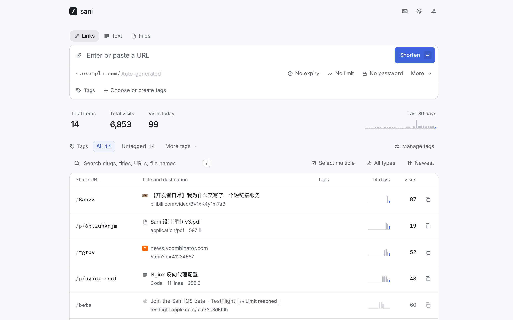

# Sani

面向单个管理员的自托管短链接、文本与文件分享服务。一个 Go 二进制文件内嵌管理界面，SQLite 保存元数据与文本，上传文件保存在本地目录，无需额外的数据库或缓存服务。

[](https://github.com/DejavuMoe/sani/actions/workflows/ci.yml)
[](https://github.com/DejavuMoe/sani/releases/latest)
[](LICENSE)

[文档](docs/guide/introduction.md) · [下载](https://github.com/DejavuMoe/sani/releases) · [English](README.md)

<picture>
  <source media="(prefers-color-scheme: dark)" srcset="docs/public/screenshots/dashboard-dark-en.png">
  
</picture>

粘贴长链接，按下回车即可将短链接复制到剪贴板。Sani 会自动获取目标网页标题与图标以便辨认。点击统计采用异步内存聚合，不会阻塞跳转流程。除核心功能外无冗余后台交互与干扰。

- **内存缓存跳转**：短链接直接从内存返回。在一台 8 核笔记本上约每秒 13 万次请求，中位延迟不到 1 毫秒，且每次有效点击均被统计（见下方[性能](#性能)）。
- **操作交互便捷**：在页面任意位置粘贴或拖入链接即可触发创建。自定义短码边输入边校验可用性。控制台支持全键盘快捷键操作。删除操作提供撤销提示，不使用阻塞式确认弹窗。
- **轻量聚合统计**：提供总点击量、每日趋势、主要来源网站及最近访问记录。网络爬虫、链接预览、浏览器预取以及管理员自身在控制台中的点击均不计入。
- **标签分组管理**：创建和编辑短链接、文本、文件时可分配标签，支持按标签筛选或查看未标记项目。标签仅管理员可见。
- **链接精细控制**：支持设置过期时间、访问次数上限，切换 302 临时或 301 永久跳转，并可随时停用。修改目标链接即时生效。
- **文本与文件分享**：支持分享不超过 1 MB 的纯文本/代码（等宽排版并带行号），以及默认上限 99 MB 的文件，统一挂载在 `/p/…` 路径下，同样支持有效期、访问上限与点击统计。文件上传和原始内容下载需要单独配置独立文件域名。
- **工作流与工具集成**：提供浏览器书签小工具、Android 系统分享菜单接入（PWA 添加到主屏幕后），提供供脚本与自动化调用的 API 令牌，并支持从 Shlink 或 Sani CSV/JSON 格式导入数据。
- **支持中文短码**：支持形如 `s.example.com/简历` 的短码，短码不区分大小写。
- **双语与主题适配**：支持中英文界面切换与深浅主题切换，适配桌面端与移动端交互。

## 文档

Sani 面向单实例、单管理员使用，不提供多用户托管或多实例同时写入能力。目前仍处于 0.x 阶段，升级前请阅读[兼容规则](docs/project/versioning.md)和更新日志。对外服务前应配置 HTTPS、持久化存储，按需设置独立文件域名，并演练[完整备份与恢复](docs/guide/operations.md)。仓库测试和公开基准不代表具体部署的容量或可用性保证。

完整的中英文文档位于 [docs/](docs/) 目录：包含[部署](docs/guide/deploy.md)与[运维](docs/guide/operations.md)指南，[配置项](docs/reference/configuration.md)、[HTTP API](docs/reference/api.md) 与[命令行](docs/reference/cli.md)参考，以及系统内部架构说明。文档站点基于 VitePress 构建，运行 `make install docs-dev` 即可在 `127.0.0.1:5174` 本地预览；部署页面内置配置生成器，输入域名即可生成完整部署文件。文档在构建时会与源码进行自动化一致性校验，确保文档记录的配置项、接口、错误码及命令均与程序实际实现保持一致。

## 快速开始

### Docker Compose

```sh
mkdir sani && cd sani
curl -fsSLO https://raw.githubusercontent.com/DejavuMoe/sani/master/compose.yaml
# 在 compose.yaml 里设置 SANI_BASE_URL（以及 TZ），然后：
sudo install -d -m 750 -o 65532 -g 65532 ./sani-data
docker compose up -d
```

打开 `http://127.0.0.1:8080/admin/`，初始化管理员密码。首次设置时需要输入 Sani 打印在启动日志中的一次性设置码（通过 `docker logs sani` 查看），以避免新建实例在未设密时被未授权访问；若配置了 `SANI_BASE_URL`，日志中还会输出已携带设置码的初始化链接。亦可预先通过环境变量 `SANI_PASSWORD` 指定密码直接跳过此步骤。对外提供服务时请在前端配置 TLS 反向代理，[deploy/](deploy/) 目录提供了 Caddy、nginx 和 systemd 的参考配置。

镜像 `ghcr.io/dejavumoe/sani` 基于 `scratch` 构建，支持 `linux/amd64`、`linux/arm64` 和 `linux/arm/v7`：约 25 MB，以非特权用户运行，数据保存在 `/data` 卷中。

模板固定使用 `v0.9.8`，镜像标签保留 `v`，与 Git tag、Release 一致。请使用已发布的版本，升级时手动修改标签。数据默认绑定到 Compose 文件旁的 `./sani-data`，容器内路径为 `/data`。上面的 `install` 命令不能省略：它创建目录并设置 `65532:65532` 所有权，让容器可以写入。如果此前启动已创建了 root 所有的目录，请先[修复权限](docs/guide/deploy.md#data-permissions)。

### 单个二进制文件

每个[版本](https://github.com/DejavuMoe/sani/releases/latest)都提供 Linux、macOS、Windows 和 FreeBSD 的压缩包，附校验和与构建来源证明：

```sh
curl -fsSL https://github.com/DejavuMoe/sani/releases/download/v0.9.8/sani-linux-amd64.tar.gz | tar -xz sani
SANI_BASE_URL=https://s.example.com ./sani
```

二进制文件内嵌了管理界面，运行时无需其他外部依赖。如需从源码编译，运行 `make install build`（需要 Go 1.27+、Node 24 与 pnpm），构建产物位于 `./bin/sani`。若遗忘密码，运行 `sani passwd` 可重置密码并使所有已登录会话失效（在 Docker 中执行：`docker exec -it sani /sani passwd`）。

## 配置

服务器通过环境变量配置；创建默认值也可在后台保存，重启后保留。各字段按“内置默认值 → 已保存设置 → 显式环境变量”取值；创建相关变量留空即可保留后台编辑能力。示例见 [.env.example](.env.example)，每一项的详细说明见[配置项](docs/reference/configuration.md)。

| 变量 | 默认值 | 说明 |
|---|---|---|
| `SANI_LISTEN` | `:8080` | 监听地址。 |
| `SANI_DATA_DIR` | `data` | `sani.db` 和分享文件（`files/`）所在目录。 |
| `SANI_BASE_URL` | — | 短链接使用的域名，如 `https://s.example.com`。不设置时使用你当前访问的地址，也可以在设置页里修改。 |
| `SANI_PASSWORD` | — | 固定的管理员密码（至少 8 个 Unicode 码点、最多 1,024 个 UTF-8 字节）。不设置则在首次访问时设置。 |
| `SANI_SETUP_CODE` | 随机 | 首次设置密码时要填写的设置码。默认在还没有密码时每次启动随机生成，并打印到日志里。 |
| `SANI_ROOT_REDIRECT` | — | 访问根路径 `/` 时跳转到哪里，默认进入管理界面。 |
| `SANI_TRUST_PROXY` | `false` | 信任 `X-Forwarded-*` 和 `X-Real-IP`，客户端地址取 `X-Forwarded-For` 的最后一项。只在会设置这些请求头的反向代理之后开启。 |
| `SANI_SLUG_LENGTH` | `5` | 自动生成的网址短码长度（3–32 的整数）。默认字符集为 `23456789abcdefghjkmnpqrstuvwxyz`，排除 0/o、1/l/i。 |
| `SANI_TEXT_SLUG_LENGTH` | `10` | 自动生成的文本／代码分享短码长度（3–32 的整数），独立于网址和文件，始终排除易混淆字符。 |
| `SANI_FILE_SLUG_LENGTH` | `10` | 自动生成的文件分享短码长度（3–32 的整数），独立于网址和文本，始终排除易混淆字符。 |
| `SANI_EXCLUDE_CONFUSABLE` | `true` | 自动网址短码排除 0/o、1/i/l。 |
| `SANI_META_PROXY` | — | 可选网页信息 HTTP/HTTPS/SOCKS5 代理覆盖值；未设置时可在后台配置。 |
| `SANI_FETCH_META` | `true` | 为新链接获取网页标题和图标。不会访问内网、本机等私有地址。 |
| `SANI_FORWARD_QUERY` | `true` | 把访问者的查询参数带到目标链接上（`/gh?utm_source=x`）。 |
| `SANI_CACHE_SIZE` | `100000` | 内存中缓存的跳转目标数量。 |
| `SANI_FILES_URL` | — | 第二个域名，如 `https://f.example.com`，指向同一个 Sani，用来提供分享的文件和原始文本。分享文件必须设置。 |
| `SANI_MAX_FILE_MB` | `99` | 未设置时为十进制 99 MB；显式设置仍按 MiB 计算（1–4096）。 |
| `SANI_LOG_LEVEL` / `SANI_LOG_FORMAT` | `info` / `text` | 日志级别 `debug`…`error`；格式 `text` 或 `json`。 |
| `TZ` | 系统时区 | 每日统计按这个时区划分日期。 |

管理界面位于 `/admin/`，API 位于 `/api/`，分享的文本和文件位于 `/p/`，其余路径都是短链接。`admin`、`api`、`p`、`rest`、`healthz`、`robots.txt` 和几个网站图标文件名是保留的，不能用作短码。

## 日常使用

**快捷键**：`N` 新建 · `/` 搜索 · `J`/`K` 上下移动 · `回车` 展开 · `C` 复制 · `E` 编辑 · `Del`（macOS 为 `⌘⌫`）删除（支持撤销）· `X` 多选链接以批量启用、停用或删除 · `Esc` 收起 · `?` 查看完整快捷键列表。在页面任意空白处粘贴链接，即可直接触发缩短创建流程。

**书签小工具**：进入“设置 → 快捷方式”，将“缩短此页”拖拽至浏览器书签栏。点击后将弹出小窗并自动填充当前页面的网址与标题；核对后点击“缩短”，即可创建或复用已有短链接并自动复制结果。

**移动端支持**：在 Android 系统上使用支持 Web Share Target 的浏览器将 Sani 安装为 PWA 后，可直接从其他系统的分享菜单接收网址并预填；核对无误后点击“缩短”即可。具体支持情况取决于浏览器与操作系统。

**API（v0.9.8）**：API 路由自 v0.9.5 起调整；从 v0.9.4 或更早版本升级时，须按[当前 API](docs/reference/api.md)更新调用脚本。旧版本契约请查看 [API 归档](docs/reference/api-archive.md)。先在设置中保存固定分享域名并创建 API 令牌，然后：

```sh
curl -X POST https://s.example.com/api/v1/links \
  -H "Authorization: Bearer sani_…" \
  -H "Content-Type: application/json" \
  -d '{"target_url": "https://example.com/some/long/path", "custom_slug": "demo"}'
```

每个接口和错误码的说明见 [HTTP API](docs/reference/api.md)。

Sani 资源 API 使用 `/api/v1`，后台能力使用 `/api/admin/v1`；遵循统一 HTTP 状态与错误格式。升级前先在旧后台导出 JSON，正常停机并完整备份数据库、文件与配置；新版执行 `sani preflight` 后原地迁移，无需重新导入。回滚必须恢复升级前完整快照并使用旧镜像/二进制。详见[新版 API](docs/reference/api.md)与 [v0.9.4 API 归档](docs/reference/api-archive.md)和[升级说明](docs/guide/operations.md#upgrade)。

**文本与文件分享**：链接输入框顶部的“文本”与“文件”标签页可用于分享纯文本、代码段或文件；在页面任意位置直接粘贴文本或拖入文件亦可触发创建。访问者可在 `/p/{短码}` 页面查看、复制或下载对应内容；只有管理员具备创建权限。新实例中自动生成的文本/代码与文件短码默认长度均为 10 位，均支持独立配置为 3–32 位（长度不含 `/p/` 前缀）。分享短码始终排除易混淆字符；低于 10 位仍可保存，系统会提示短码过短容易被未授权枚举，任何获知地址的访问者均可查看。

首次升级时，缺少独立设置的分享短码长度将按 `max(10, 旧版有效网址短码长度)` 写入并保留原有较长配置。后续调整网址短码长度不会影响文本与文件短码，既有及手动指定的短码保持不变，详见[长度配置](docs/reference/configuration.md#sani-text-slug-length)。

**导入与导出**：进入“设置 → 数据”，可将网址链接与标签导出为 JSON 或 CSV 格式；文本内容、上传文件与点击明细需通过数据库及文件完整备份保存。数据导入仅支持 Sani 原生及 Shlink 的 CSV/JSON 文件，控制台与文档均提供了原生格式规范示例。导入时已存在的短码将被自动跳过并标注原因。跨实例完整迁移建议使用 JSON：CSV 会为疑似电子表格公式的字段添加前导单引号以防注入，重新导入时会完整保留该符号。

**访问者看到的页面**：短码不存在时显示简洁的 404 页面；链接过期、停用或次数用完时显示 410 页面。页面会按访问者的浏览器语言显示中文或英文。

## 性能

`make load` 会用 [bombardier](https://github.com/codesenberg/bombardier) 压测发布版构建：128 个并发连接，持续 15 秒。压测工具和服务运行在同一台 8 核笔记本上（Intel Core Ultra 7 255H，WSL2）。

| 路径 | 每秒请求数 | p50 | p99 |
|---|---|---|---|
| 命中缓存的跳转（计入点击） | 141,972 | 0.75 ms | 3.12 ms |
| 带访问次数上限的跳转 | 145,048 | 0.73 ms | 3.00 ms |
| 不存在的短码（404 页面） | 103,161 | 1.02 ms | 4.15 ms |

脚本在执行结束后会核对数据库记录的点击总数与实际完成的跳转响应数。在上述测试运行中，共完成了 2,129,275 次跳转，记录了 2,129,275 次点击，两者完全一致。若单独衡量 HTTP 处理函数本身，每次跳转开销约 0.61 微秒（`make bench`）。数据测定于 2026-10-10 的开发工作树；宿主机负载与调度争用会影响耗时，测试脚本每次运行均自动校验计数一致性。

实现机制：

- 跳转目标存储于 SQLite 前置的分片内存缓存中。针对不存在的短码设置了带容量上限的负缓存，随机枚举短码不会导致有效链接被逐出缓存；相同短码的并发未命中仅触发一次数据库查询。
- 记录点击仅在内存中执行原子累加。聚合后的点击量每两秒通过单事务批量刷写至 SQLite，服务优雅停机时亦会同步刷写。
- SQLite 配置为 WAL 模式，采用单一写连接配合读连接池，常规读写可并发执行。连接池与文件锁可能发生短暂排队；命中缓存的跳转不会阻塞等待数据库写盘。
- 管理前端静态资源内嵌于二进制程序中，并在构建阶段预先完成 Brotli 与 gzip 压缩。

测试方法和微基准测试见文档里的[性能](docs/internals/performance.md)。

## 项目结构

```
cmd/sani            入口：serve、passwd、backup、healthcheck、version
internal/server     HTTP：跳转、JSON API、内嵌界面、访问者页面
internal/cache      跳转缓存：未命中缓存与写入竞争保护
internal/clicks     点击的内存聚合与批量写入
internal/store      SQLite（modernc.org/sqlite，无 cgo）、迁移与查询
internal/links      短码规则、URL 规范化、Location 头编码
internal/meta       带 SSRF 防护的标题与图标获取
internal/auth       argon2id 密码、令牌、登录限流
web/                管理界面：Svelte 5 + TypeScript，Vite 构建
docs/               文档站：VitePress，构建时与源码核对
```

安全方面（详见文档里的[安全](docs/internals/security.md)）：

- 会话 Cookie 为 HttpOnly、SameSite=Strict，只作用于 `/api/`，跨站请求一律拒绝（`http.CrossOriginProtection`）。
- API 令牌和会话凭据只保存 SHA-256 哈希，密码使用 argon2id。
- 新实例只有同时提供启动日志里的设置码，才能设置第一个密码；登录和首次设置都按客户端限流。
- 管理界面启用严格的 CSP，除带哈希的主题初始化脚本外不允许内联脚本。
- 抓取解析的网站图标以限制性内容类型与安全标头返回；独立文件域名同样遵循隔离策略：分享文件与原始文本均以沙箱化或附件模式提供，且该域名不携带管理端登录凭据与 Cookie。
- 目标链接禁止使用 `javascript:`、`data:`、`file:` 等伪协议。抓取页面标题时拦截内网、本机和链路本地地址，并在 DNS 解析后执行二次校验以防 DNS 重绑定。
- 由于 HTTP Referer 标头可由客户端任意伪造，每条短链接最多记录 200 个不同来源网站，超出部分统一归入“其他来源”。

## 开发

```sh
mise install          # 按 mise.toml 安装 Go、Node、pnpm
make install          # 安装管理界面和文档站的依赖（同一个 pnpm 工作区）
make dev-backend      # API 运行在 127.0.0.1:8080
make dev-frontend     # Vite 运行在 127.0.0.1:5173/admin/，/api 代理到后端
make demo             # 带演示数据的本地实例（密码：sani-demo）
make docs-dev         # 文档站运行在 127.0.0.1:5174
make check test e2e   # gofmt、vet、类型检查、文档核对；Go（-race）与单元测试；Playwright
make load             # 上面的压测
```

改动需要遵守的规则见文档里的[参与开发](docs/project/development.md)，提交改动的方式见 [CONTRIBUTING.md](CONTRIBUTING.md)。安全问题请[私下报告](SECURITY.md)，不要公开提交 issue。

## 数据与备份

短链接元数据与文本内容统一存储于 `SANI_DATA_DIR` 目录下的 `sani.db` 中（WAL 模式的 SQLite 数据库）；上传的分享文件保存在同级的 `files/` 目录。`sani backup FILE` 可以在服务运行期间导出具有事务一致性的数据库快照，该快照不包含磁盘文件和尚未刷盘的内存点击；当输出文件名指定为 `-` 时，备份直接输出至标准输出。基础镜像不含独立 Shell，因此 Docker 环境下推荐如下备份方式：

```sh
(umask 077; set -C; docker exec sani /sani backup - > sani-backup.db)
```

完整数据备份需先停机以确保所有写入停止，随后对数据库与 `files/` 目录进行完整同步。恢复时应恢复至新的干净目录，避免混用历史 WAL 文件或残余文件；完整备份、数据恢复与升级回滚步骤详见[运维指南](docs/guide/operations.md)。如仅需迁移或导出短链接列表，可通过“设置 → 数据 → 导出”获取 JSON 或 CSV 文件（不包含文本内容与上传文件）。

## 许可证

[MIT](LICENSE)
